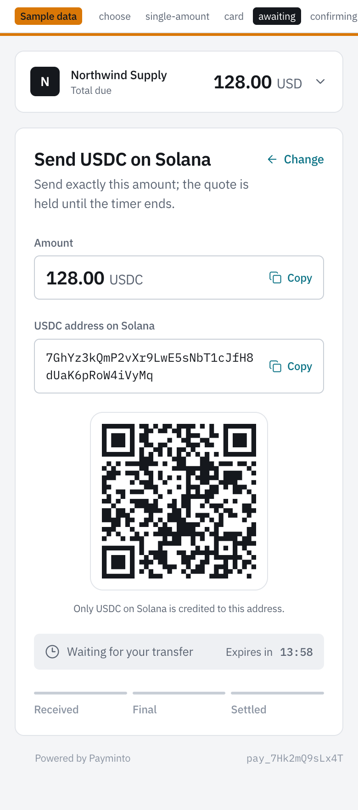
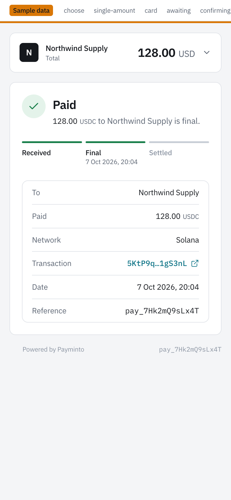

# Solana at Crypto World's Fair

Payminto accepts USDC and USDT on Solana and books deposits through the gateway's double-entry ledger.
The current showcase pairs this rail with [Tempo](../tempo/README.md) under [Crypto World's Fair](https://colosseum.com/worldsfair).
See [project status and prior-work disclosure](../../docs/WORLDS_FAIR.md).

## Implemented path

- Each payment receives a deposit owner and associated token account.
- The watcher reads signatures and parsed transaction evidence, preserving cursors when an RPC node cannot return a listed transaction.
- Finalized deposits are credited from observed account balance changes; wrong mints, native SOL, and unsupported Token-2022 transfers raise anomalies.
- USDC and USDT remain distinct assets, `USDC.SOLANA` and `USDT.SOLANA`.
- Sweeps batch token transfers with a separate fee payer, book network fees in SOL, and reclaim rent from empty accounts.
- Persisted signatures, sweep locks, and status/version compare-and-set transitions support recovery after crashes or competing workers.
- Deposits are marked swept only after a finalized attempt is booked.

Live configuration requires at least two distinct RPC endpoints for drop and expiry evidence.
The complete sweep rules are in [SOLANA_SWEEPS.md](../../backend/internal/service/SOLANA_SWEEPS.md).
Payment links, switch integration, and additional providers remain subject to the [unfinished-work disclosure](../../docs/WORLDS_FAIR.md#verification-and-unfinished-work).

## Code and validation

| Path | Purpose |
| --- | --- |
| [Blockchain adapter](../../backend/internal/blockchain/solana/) | Keys, token accounts, RPC, parsing, and sweep construction. |
| [Deposit watcher](../../backend/internal/service/solana_deposit_service.go) | Signature polling, finality, anomalies, and deposit handling. |
| [Sweep service](../../backend/internal/service/solana_sweep_service.go) | Claims, attempts, confirmations, and ledger booking. |
| [Module wiring](../../backend/internal/modules/solana.go) | Environment, mint, and RPC policy. |
| [Local-validator test](../../backend/internal/service/solana_integration_test.go) | Payments to token/owner accounts, wrong mint, partial payments, and sweeps. |

Recorded-RPC unit tests and crash/race regression probes cover the deposit and sweep paths.
The local-validator test requires `solana-test-validator` and skips when that executable is absent; a skipped run is not passing chain verification.
Inspect database harnesses before running integration tests and use disposable targets only.
The [contribution guide](../../CONTRIBUTING.md) lists scoped commands.

## Public and preview evidence

The existing public test deployment advertises Solana USDC.
Implementation and local test coverage for USDT and sweeps do not establish that those features are enabled on the public deployment.
The [demo walkthrough](../../DEMO.md) identifies the real-payment path and sample previews.

| Address preview | Paid preview |
| --- | --- |
|  |  |

These screenshots are sample-data design previews, not receipts for actual payments.
Custody providers, conversion through Jupiter, and additional RPC presets remain future or unmerged work.
